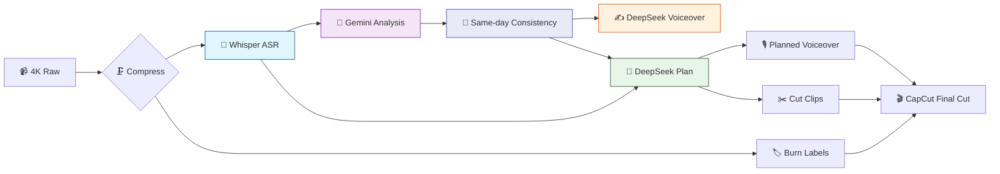

# 🎬 Clio — AI Preprocessing Pipeline

> 🧠 **Raw footage → Compress → AI understands → Same-day consistency → Voiceover scripts → Edit plans → CapCut final cut**
>
> A CLI + Web UI tool designed for solo travel vloggers. Feed your GoPro/phone 4K footage to AI, get summaries, timelines, voiceover scripts, and edit plans — then put the final touches (effects, lip-sync) in **CapCut (JianYing)**.

[](https://github.com/Leisurelybear/Clio/actions/workflows/test.yml)
[](https://codecov.io/gh/Leisurelybear/Clio)

[](LICENSE)

**English** · [简体中文](README.md)

---

## ✨ Features

| | Feature | AI | Description |
|---|---------|----|-------------|
| 🗜️ | **Smart Compression** | | 4K → 640p · mono 64 kbps audio by default · short clips use a size budget, while long clips keep an 800 kbps analysis floor (logical windows) |
| 🤖 | **AI Video Understanding** | ✅ Gemini | Watches footage → title / location / mood / summary / timeline |
| ✍️ | **AI Voiceover** | ✅ DeepSeek | Writes narration from template + AI analysis |
| 📋 | **AI Edit Planning** | ✅ DeepSeek | AI arranges segment order, target duration, theme |
| 🧠 | **AI ASR Transcription** | ✅ Whisper / Cloud ASR | faster-whisper offline ASR or Aliyun Paraformer cloud ASR, switchable in project settings |
| 🔧 | **AI Refine** | ✅ DeepSeek | Review + fix output with trip context, `--fix` support |
| 🏷️ | **Label Burn-in** | | Burn index watermark onto compressed video |
| ✂️ | **Precision Cutting** | | Plan-based cutting, fast or re-encode |
| 🌐 | **Web UI Editor** | | Zero deps, browser-based editing & pipeline |
| 🗂️ | **Task Center & Notifications** | | Cross-project persistent background tasks, live progress, retries, and inbox |
| 🚀 | **One-shot Pipeline** | ✅ | `run --day day1` covers compress → transcribe → analyze → same-day consistency → voiceover → plan → planned voiceover → labels; run `cut` separately |

---

## 🖥️ Web UI Editor

**Pure Python stdlib** (`http.server`). No Node.js, no npm, no build step.

<div align="center">
  
  <br><sub>🏃 Pipeline runner</sub>
  <br><br>
  
  <br><sub>🤖 AI analysis editor</sub>
  <br><br>
  
  <br><sub>✍️ Voiceover editor</sub>
  <br><br>
  
  <br><sub>📋 Edit plan</sub>
  <br><br>
  
  <br><sub>📁 Project management</sub>
</div>

- 🎥 **HTML5 Player** — seek / jump / speed (0.5x–2x) / Range requests
- 📂 **Source Toggle** — switch between compressed / original view
- 📝 **Three Editing Tabs** — Analysis / Voiceover / Plan, Ctrl+S to save
- ⚙ **Visual Config Editor** — Full YAML form, global & per-project modes
- ▶ **Pipeline Runner** — Step-by-step or full run, live progress + ETA
- 🔄 **Local Whisper Model Download** — One-click in UI, auto-rerun transcription; cloud engines need no model download
- 🗂️ **Task Center & Notifications** — Browse task history and live status across projects with cancel/retry; task events and UI warnings land in a filterable notification inbox

Launch: `python main.py serve` → open `http://127.0.0.1:8765`

Security notes:

- By default the UI listens on `127.0.0.1`, so only the local machine can access it.
- `python main.py serve --host 0.0.0.0` exposes the UI to your LAN; other devices may access project directories, video previews, and config APIs. Use it only on trusted networks.
- When exposing the UI to a LAN, prefer `--token <random-long-string>`. If omitted, the server auto-generates an API token and prints a `Token URL` in the terminal.
- Do not expose the UI directly to the public internet. Use a VPN or SSH tunnel for remote access.

---

## 🧩 Pipeline Steps



| Step | AI Engine | Command | Input → Output |
|------|-----------|---------|---------------|
| 1️⃣ Compress | | `compress` | 4K raw → 640p file; 5 MB is a configurable size budget, with video bitrate bounded to 800–8000 kbps and mono 64 kbps audio by default (one file per source) |
| 2️⃣ 🧠 **AI Transcription** | **Whisper** / cloud ASR | `transcribe` | Compressed video → speech transcript (local or cloud) |
| 3️⃣ 🤖 **AI Analysis** | **Gemini** 2.5 Flash | `analyze` | Compressed video + transcript → AI summary + timeline JSON |
| 4️⃣ 🧩 **Same-day Consistency** | **DeepSeek** / OpenAI | `run --day day1` | Daily analysis JSON → normalized entities + duplicate-scene markers |
| 5️⃣ ✍️ **AI Voiceover** | **DeepSeek** / OpenAI | `scripts` | Analysis JSON → AI-generated narration |
| 6️⃣ 🤖 **AI Planning** | **DeepSeek** / OpenAI | `plan --day day1` | Analysis + transcripts + consistency → AI edit plan |
| 7️⃣ 🎙️ **Planned Voiceover** | **DeepSeek** / OpenAI | `run --day day1` | Plan segments + transcript → segment-aligned narration |
| 8️⃣ 🔧 **AI Refine** | **DeepSeek** / Gemini | `refine` | Existing output + trip context → AI correction |
| 9️⃣ Cut | | `cut --day day1` | Plan → timestamp-based clip extraction |
| 🔟 Label | | `label` | Compressed video → burned index watermark |
| 🚀 Full Pipeline | AI + media | `run --day day1` | Compress → transcribe → analyze → same-day consistency → voiceover → plan → planned voiceover → labels; run `cut` separately |

> 💡 Supports **single-file** processing: `python main.py analyze -i "output/compressed/001_GL010685.mp4"`
> 💡 Each step independently skips existing output; add `--force` to regenerate

---

## 🚀 Quick Start

### 📦 One-line Setup

```bash
# Windows 🪟
.\setup.ps1

# Linux / macOS 🐧
./setup.sh
```

Auto-creates venv → installs deps → installs ffmpeg → creates `.env`.

### 🔑 Configure API Keys

```bash
# Edit .env with your keys
GEMINI_API_KEY=your_Gemini_API_Key
DEEPSEEK_API_KEY=your_DeepSeek_API_Key
```

### ⚙️ Edit Config

Configuration is split into two layers:

- **`config.yaml`** (global): AI providers, default task bindings, proxy, codec settings, and other cross-project defaults
- **`project.yaml`** (project-local): AI context, task overrides, compression size, Whisper language, and other per-project settings

```bash
cp config.example.yaml config.yaml
# Global config: edit ai.providers, ai.default_tasks, etc.
# Project config: place project.yaml in the project directory (see docs/project.example.yaml)
```

### 🌐 Language

The UI ships in **Chinese and English**. Three ways to switch (lowest to highest precedence):

1. **Web UI**: click the `中` / `EN` button in the header for a one-click switch (no reload), or use Settings → Global → `Interface language` and save
2. **Config file**: `config.yaml` → `ui.language: en` (or `zh-CN`)
3. **Environment variable**: `CLIO_LANG=en python main.py check` (highest precedence; handy for CLI runs)

CLI, doctor and Web UI copy all follow the same setting.

### ▶️ Run It

```bash
# 🏃 Full pipeline
python main.py run -i "E:/Videos/🇫🇷ParisTrip" --day day1

# 🔍 Environment check
python main.py check

# 🌐 Launch UI
python main.py serve
```

---

## 🧠 Multi-Provider AI

| Task | Recommended | Type | Description |
|------|-------------|------|-------------|
| 🎬 Video Analysis | **Gemini** 2.5 Flash | Multimodal | Watches video, outputs title/location/timeline |
| ✍️ Voiceover | **DeepSeek** / OpenAI | Text | Generates narration from template |
| 📋 Edit Plan | **DeepSeek** / OpenAI | Text | Arranges segment sequence |
| 🔧 Refine | Same (configurable) | Text | Fixes output with trip context |

Global task bindings live in `config.yaml` → `ai.default_tasks`, so new projects do not need to choose a provider/model again. A project can override any task in `project.yaml` → `ai.tasks`; unset tasks inherit the global default. `refine_text` follows the project's effective `video_analyze` binding by default and can also be overridden explicitly. Supported backends include **OpenAI-compatible APIs** (Tongyi Qianwen, Kimi, etc.) and local **Ollama** (`type: ollama`, no API key required, default `http://localhost:11434/v1`). Providers declare `video` / `text` capabilities through `capabilities`; video-analysis tasks automatically filter and validate for video-capable providers. OpenAI-compatible providers can set `timeout_sec` for slow gateways or local models. Gemini providers can set `video_upload_max_mb` to change the per-file upload limit (default: 200 MB; larger files must be compressed first).

📌 **Automatic trip context injection**: write your trip background and known pitfalls once in `templates/trip_context.md`, injected into every AI call.

---

## 🎯 Typical Workflow

```
📹 Home from a shoot, plug in GoPro SD card

> python main.py run -i "E:/2025-10 Paris" --day day1
>   ⚙️ Compress source files (size budget for short clips, analysis floor for long clips)
>   ⚙️ Scan 3 logical analysis windows (34min total; no physical slices)
> ── 🤖 AI takes over ──────────────────
>   ✅ Whisper / Cloud ASR done → local or cloud engine
>   ✅ Gemini analyzed footage → titles / timelines / summaries
>   ✅ DeepSeek normalized same-day entities → duplicate scenes marked
>   ✅ DeepSeek wrote the full voiceover script → templated style
>   ✅ DeepSeek planned edit order → 11 segs / ~3min
>   ✅ DeepSeek wrote planned-segment voiceover → aligned to selected clips
>   ✅ Index labels burned

> python main.py cut --day day1
>   ✅ Clips cut by plan → output/cuts/day1/

> python main.py serve
  → Browser: review AI output, tweak scripts, reorder, preview

📱 Open CapCut, import output/cuts/day1/, drag, add effects, done!
```

---

### Cloud ASR Configuration

The default engine is local faster-whisper. To use the Aliyun cloud engine:

1. Enable the service in [Alibaba Cloud Model Studio](https://bailian.console.aliyun.com/) and create an API key
2. Add `DASHSCOPE_API_KEY=sk-...` to `.env`
3. Set `whisper.engine: aliyun` in project settings (Web UI or `project.yaml`)

Readiness checks follow the active engine: `local` checks faster-whisper/cuBLAS, while cloud
engines check only their own credentials. The transcript panel, run panel, video menu, and empty
states show the corresponding local-model or cloud-credential guidance.

Changing engines makes existing transcripts stale, so `skip_existing` re-transcribes them and
records the reason in the task log. A new cloud provider only needs a registered
`TranscriptionProvider` under `clio/asr/`; the UI engine list updates automatically.

---

## 📁 Project Structure

```
vlog-video-analysis/
├── main.py                    # 🎯 CLI entry
├── config.example.yaml        # 📋 Config template
├── setup.ps1 / setup.sh       # 🚀 One-click installer
├── serve.ps1 / serve.sh       # 🌐 One-click UI launcher
├── templates/
│   ├── trip_context.md        # 🗺️ Trip background (auto-injected)
│   └── vlog_template.md       # 📝 Voiceover template (customizable)
├── clio/
│   ├── compress.py            # 🗜️ ffmpeg wrapper
│   ├── analyze.py             # 🤖 AI analysis logic
│   ├── transcribe.py          # 🎙️ Whisper ASR
│   ├── prompts.py             # 💬 All prompt templates
│   ├── pipeline.py            # 🔄 Pipeline orchestration
│   ├── config/                # ⚙️ Config parsing / validation
│   ├── asr/                   # 🎙️ ASR provider registry (local / aliyun / extensible)
│   ├── ai/                    # 🧠 AI adapters (Gemini / OpenAI compat)
│   ├── tasks/                 # 📂 Step implementations
│   ├── ui/                    # 🌐 Web UI (stdlib only, zero deps)
│   └── tests/                 # 🧪 Backend and Web API tests
└── output/
    ├── compressed/            # 🗜️ Compressed videos
    ├── texts/                 # 📝 AI analysis JSON
    ├── transcripts/           # 🎙️ ASR transcripts JSON
    ├── scripts/               # ✍️ Voiceover scripts
    ├── plans/                 # 📋 Edit plans
    ├── cuts/                  # ✂️ Cut segments
    └── labeled/               # 🏷️ Label-burned videos
```

---

## 🧪 Testing & Quality

```bash
# Run all backend tests
python -m pytest clio/tests/ -v

# Frontend typecheck and unit tests require Node.js 22.12+ (the Web UI itself does not)
npm run typecheck
npm test

# Test counts are authoritative in the GitHub Actions CI matrix
# CI: Ubuntu + Windows + macOS · Python 3.11 / 3.12; Node 22.12+
# Code style: ruff (format + lint)
```

Primary coverage areas:

- ⚙️ Config loading, merging, validation, and upgrades
- 🤖 Gemini / OpenAI-compatible / Ollama providers, retries, caching, and structured output
- 📂 Compression, transcription, analysis, same-day consistency, planning, cutting, and export orchestration
- 🌐 Web routes, path safety, task center, SSE, and error responses
- 🖥️ Frontend save/conflict flows, plan history, player preview, and i18n

> Run the full pytest and Vitest suites locally; the exact counts remain authoritative in the GitHub Actions CI matrix (Python 3.11 / 3.12; Node 22.12+).

---

## 📚 Documentation

| Doc | Description |
|-----|-------------|
| [AGENTS.md](AGENTS.md) | 🧑‍💻 AI maintenance manual (structure / conventions / gotchas) |
| [ROADMAP.md](ROADMAP.md) | 🗺️ Feature tracking & roadmap |
| [docs/cli-reference.md](docs/cli-reference.md) | 📖 Full CLI reference |
| [clio/ui/README.md](clio/ui/README.md) | 🖥️ Web UI detailed guide |

---

---

## ❓ FAQ

### ffmpeg not found

Run `.\setup.ps1` (Windows) or `./setup.sh` (Linux/Mac) to auto-install, or set paths manually in `config.yaml`.

### socksio package not installed

```bash
python -m pip install -r requirements.txt
```

### File is not in an ACTIVE state

The tool polls automatically for Google's video processing; if it fails, retry later.

### ConnectTimeout / network errors

Check your proxy settings in `config.yaml`.

### pip install fails

Make sure you're using the project virtual environment (Windows: `.venv\Scripts\activate`, Linux/Mac: `source .venv/bin/activate`):

```bash
python -m pip install -r requirements.txt
```

### Re-analyze a single video

Delete the corresponding `.json`/`.txt` from `output/texts/`, or set `analyze.skip_existing: false`.

---

## 🤝 Contributing

Personal vlogger tool — [Issues](https://github.com/Leisurelybear/Clio/issues) and PRs welcome.

```bash
.venv\Scripts\activate         # Windows
source .venv/bin/activate      # Linux/Mac
ruff format .                  # Format
ruff check .                   # Lint
python -m pytest -v            # Test
```

---

## 🚀 Future Vision

> This is just the beginning. Here's what we're exploring:

| Vision | Description |
|--------|-------------|
| 🧠 **Local AI Inference** | Integrate llama.cpp / ollama for fully offline, zero-cost, privacy-first inference |
| 🖼️ **AI Thumbnail Generation** | Auto-select frames + overlay titles for YouTube / Bilibili covers |
| 🌍 **Multi-language Voiceover** | AI translates Chinese voiceover to EN / JP / FR etc. |
| 🎵 **AI Music Recommendation** | Analyze video mood → suggest matching BGM with auto beat sync |
| 🤝 **Collaborative Editing** | Project sharing, cloud sync for team vlog production |
| 📊 **AI Edit Scoring** | Auto-evaluate pacing, shot diversity, give improvement suggestions |
| 🏪 **Plugin Marketplace** | Third-party plugin system: custom AI steps, export templates, effects |

**Got ideas? → [Open an Issue](https://github.com/Leisurelybear/Clio/issues) ✨**

---

<p align="center">
  <b>🗜️ → 🤖 → ✍️ → 🧠 → 📋 → 🔧 → ✂️ → 🎬</b>
  <br>
  <sub>AI-powered vlog creation · From raw footage to final cut, faster</sub>
</p>
