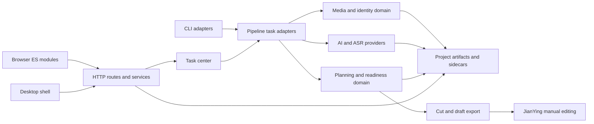

# CLIO Comprehensive Module Review (2026-11-15)

## Scope and evidence standard

CLIO has a substantial, tested preprocessing pipeline and useful separation between domain code,
task adapters, HTTP routes and browser modules. The main weaknesses found here are inconsistent
contracts at their boundaries: cache reuse, artifact resolution, asynchronous editor identity,
provider lifetime and publication of derived files. More isolated happy-path tests would not
adequately address these failures.

This is a repository-wide feature and architecture review with targeted code inspection and
offline reproductions. It is **not a certification that every line, dependency, platform or user
scenario is defect-free**. The requested whole-project scope is represented by the module map
below and the [tracked-file inventory](2026-11-15-clio-review-evidence/file-inventory.csv).
Inventory rows explicitly distinguish selected code-section review, suite execution and
area-level inventory. Uninspected individual files are not silently marked reviewed.

The repository contained 711 tracked files at inventory time, including 149 production Python
files / 42,546 lines and 81 production JavaScript files / 17,356 lines. Counts include comments
and blanks; they are not complexity or quality scores. Selected sections of 113 tracked files
are explicitly indexed as inspected. Automated execution covers additional files without
establishing manual review of every line. Source hashes and aggregate measurements are archived
in the evidence directory.

Initial HEAD was `781ae0e`. Existing local runner changes were preserved. During the audit,
another working process committed `2ecc9b6`, `6a362a2`, `cfe93e3` and `aef5b0a`; their scope was
checked and the final frontend suite and backend preview tests were rerun. The final report
baseline is `aef5b0a96692a93893f680158a30044dfc867e53`. Production backend code did not change
between these baselines. Reports do not attribute another process's changes to this review.

See the [final assessment](2026-11-15-clio-final-review.md),
[repair matrix](2026-11-15-clio-review-matrix.md) and
[verification record](2026-11-15-clio-review-evidence/verification.md). R01-R17 are this audit's
local finding IDs, distinct from historical R001/OPT identifiers. All remain open.

## Architecture and data flow

The domain/task/transport split is appropriate for the product. Dataclasses, explicit task
bindings and a single staged `vlog_plan` binding keep the pipeline understandable. The Web UI
can reuse pipeline behavior without a frontend build system, and a stdlib server keeps deployment
small. Task records, project artifact serialization, bounded request parsing, media identity and
atomic writes are valuable existing foundations.

The diagram also exposes the main risk: routes can write artifacts directly while managed tasks
write them through another path. Browser state and on-disk versions form another independent
concurrency boundary. Atomic replacement protects individual files from partial writes; it does
not establish a version transaction, an atomic JSON/TXT bundle, a provider lease, or consistency
between an editor's current entity and a delayed response.

Recommended seams are narrow and problem-driven:

1. An artifact resolver owns configuration-aware roots, legacy fallback, identity and containment.
2. A persistence service owns content versions, overwrite policy and derived sidecars.
3. A read-only reuse policy owns the same validity decision for preview and execution.
4. Editor operations carry project/artifact identity and edit/request revisions.
5. Provider invalidation retires active leases rather than closing live clients.

These changes should accompany the associated fixes. A broad rewrite, a new Web framework or a
single universal manager is not justified by the evidence.

## Feature and module coverage map

| Functional area | Principal implementation | Review focus and existing strengths | Findings / remaining validation |
| --- | --- | --- | --- |
| CLI and pipeline | `main.py`, `clio/main.py`, `clio/pipeline.py` | Command dispatch, explicit paths, step options, cancellation, failure propagation | R14; O08 counts; real credential-free provider case |
| Configuration and project selection | `clio/config/`, project/config services and routes | Global/project separation, relative paths, migration, cache copies, registered project resolution | R07/R17; O07; O09; concurrent config publication not stress-tested |
| Media selection and identity | `_video_loader.py`, `identity.py`, `vmeta.py`, `index.py`, `gpmf.py` | Selection identity, deterministic slots, legacy split offsets, capture metadata | R15/R16; O02; multiple cameras and source relinking acceptance |
| Compression and probing | `compress.py`, tasks/compress, media helpers | Runtime metadata validation, FFmpeg command construction, SDR/browser-compatible output paths | R01/R02; no new HDR matrix or device corpus run |
| ASR | `clio/asr/`, tasks/transcribe, transcripts routes | Local/cloud boundaries, upload/retry, transcript mapping and cache lineage | Supported engine/noise/language corpus still requires O05 |
| AI transports and structured output | `clio/ai/`, `clio/analyze.py` | Capability checks, retries, JSON extraction, validation, provider reuse and upload cleanup | R11/R12; live gateway behavior not exercised |
| Analysis and prompt composition | tasks/analyze, prompts, scene/window helpers | Context wrapping, window-relative transcript use, coverage and merge fallback | O02/O05/O06; real temporal fidelity/hallucination limits |
| Same-day consistency | tasks/consistency, structured schemas and prompts | Day-scoped entity/duplicate reports, validation, downstream planning context | No new standalone defect established; cross-day human evaluation remains |
| Voiceover and refinement | tasks/scripts/refine, Web refine and editors | Analysis-to-script lineage and explicit task bindings | R03/R04/R13; refine lifecycle bypasses managed task policy |
| Staged planning and readiness | plan_input/model/readiness, tasks/plan | Bounded inputs, outline-selection-review stages, final validation, readiness gates | R05/R06/R13; plan metric accuracy O08 |
| Cut, preview and waveform | cut domain/tasks, plan_preview, video/waveform routes and frontend | Timeline mapping, original/compressed selection, preview freshness, lazy peaks | R07/R17; browser playback and large-project latency O05/O10 |
| Draft export | `clio/export/`, export routes | Separate export format registry, structured plan/media mapping and readiness | R09/R10; actual supported-version JianYing import remains unverified |
| Runtime and task history | task_center, progress, processing state, shutdown | Persistent states, cancellation, task ownership, logs and project keys | R03/R11/R12; O08/O10; crash/queue stress not performed |
| HTTP and access boundaries | server, handlers, route table, request body, filesystem routes | Existing auth/origin/body/path guard infrastructure and Range streaming | R08; no external penetration or hostile-network audit |
| Browser editing and navigation | state, sidebar, editor*, API helpers | Version headers, dirty prompts, escaped dynamic output, modular UI | R04-R06/R17; O01/O03; actual browser accessibility testing absent |
| Guided Run UX | runner*, stage model, diagnostics | Guided/custom paths, estimates, progress, one-action overwrite and optional-ASR skip | R01; latest runner commits tested; no live AI guided run |
| Logs, notifications and localization | logging/privacy/session helpers, logs/task center UI, catalogs | Live/history separation, catalog tests, bounded buffers and escaping patterns | R12 accounting accuracy; no new log-secret bypass asserted |
| Desktop and installation | `clio/desktop/`, ffmpeg installer, packaging | Embedded local server, API dialogs, verified dependency installation paths | O04/O05; native GUI/installers not executed |
| Tests, CI and evaluation | pytest/Vitest suites, workflows, evaluation.py | Broad behavior suite, real-FFmpeg smoke, type/lint gates and release checks | O03-O05/O10; skips and shallow static gates explained below |
| Documentation and templates | AGENTS, examples, READMEs, maintenance refs | Strong project memory and explicit invariants | O09; dated tracker authority needs careful interpretation |

## CLI, configuration and project behavior

The global/project split is explicit and the configuration model exposes effective combined
views. Project-relative path resolution and read-only default application are important existing
invariants. Configuration must remain a cross-cutting change: model, parser, examples, copy,
catalogs and tests need to move together.

The inconsistency is primarily in consumers. Configurable `texts_subdir`, `scripts_subdir` and
compressed paths are accepted by producers and indexing, while several Web readers reconstruct
default directories. R07 reproduces missing reads for files that actually exist. Avoid fixing
only one endpoint: list, read, save, refine, playback, vmeta/info and waveform must agree on the
same effective roots. Keep legacy read-only lookup and rejection of escaped paths.

The backend deliberately rejects duplicate project names with 409. That is a good fail-closed
behavior. Direct player/preloader URLs omit `project_dir` even though normal API calls preserve
it; R17 is therefore a supported multi-project playback failure, not evidence of silent backend
fallback into another project. Consolidating URL construction must preserve token, absolute
source, day, cut revision and directory parameters.

`main.py check` succeeds for the local environment used in this audit. It nevertheless applies
an unconditional key check to bound Ollama providers; R14 isolates that contradiction. Reuse
provider credential policy rather than adding another special validation implementation.

ConfigCache deep-copies values and fingerprints configuration at nanosecond resolution, which
protects caller mutation and common stale reads. Its claimed LRU eviction does not update recency
on a hit (O07). This is a small policy/documentation mismatch, not evidence of config data loss.

## Media ingestion, identity, compression and artifacts

MediaIdentity and `.vmeta`/`.vindex` are core contracts rather than incidental caches. Original
paths, numeric indices and legacy segment offsets must stay consistent through analysis, plan,
preview, cut and export. Existing tests cover many of these cases, including real FFmpeg output.

Four distinct failures should not be collapsed into one generic cache ticket:

- R01: guided preview trusts a matching stem where runtime would reject the compressed artifact.
- R02: even runtime's settings identity omits codec and effective CRF.
- R15: full-path-distinct sources write the same stem-named `.vindex`.
- R16: second-resolution source timestamps miss equal-length sub-second edits.

R15 demonstrates index overwrite, but `.vmeta` remains an independent source of identity.
The report does not assert every downstream path fails whenever filenames collide. Acceptance
must specifically exercise single-file lookup, reindex and verification in addition to normal
multi-file compression. New storage names must preserve legacy reads and reject ambiguous
fallbacks rather than selecting the first matching stem.

R16 concerns source freshness; the existing target quick hash does not fix it. Nanosecond metadata
addresses ordinary same-second edits. Workflows that preserve timestamps need a documented
content-signature policy. A sampled signature should not be represented as full-file integrity.

The code supports codec/CRF and target-size modes, browser-compatible pixel formats and HDR
handling paths. This review did not perform a new device/codec/HDR corpus comparison or measure
perceptual quality. Current synthetic tests support implementation behavior, not a claim of
optimal image quality for every camera.

Title-derived artifact stems are a separate, previously open maintenance issue (O02/historical
OPT-023). Prefer stable identity with a mutable display title. Any migration must preserve edited
files and avoid opportunistic cleanup based solely on names.

## ASR, providers, analysis and prompts

The AI layer already offers provider bindings, capability checks, native structured-output
definitions, tolerant extraction and validation retries. Analysis windowing preserves original
context and uses window-relative transcript data; summary failure fallback avoids discarding
usable merged analysis. Provider upload cleanup and retries should remain explicit boundary
contracts. Historical review fixes were checked as current behavior rather than copied back
into the new matrix as unresolved issues.

R11 identifies a different provider lifetime path from TTL retirement: config-triggered cache
clear closes providers despite active leases. Retire-on-invalidation should follow the same
active-call discipline, including acquisition/lease handoff and exactly-once close. A passing
fake-client lease probe proves premature close; it does not prove a live provider request always
fails when its client closes.

R12 is an accounting transaction problem: independent FileTokenUsageStore instances have
independent locks. Atomic file publication protects JSON validity while losing a successful
concurrent update. Totals and cost can be understated even when both AI calls succeed. Choose
a path-level transaction or a transactional store based on the supported multi-process contract;
do not merely add another atomic-write helper.

ASR implementation and tests cover local/cloud engine boundaries and transcription lineage.
No live cloud ASR or real multilingual/noisy-audio evaluation was run here. Optional disabled
transcription is supported by the latest guided UX and does not imply ignoring reusable
transcripts. Any ASR change must keep those semantics separate.

Prompt/schema correctness does not establish factual AI quality. A schema-valid timeline can
still misidentify people, omit scenes or assign inaccurate times. The evaluation fixtures and
fake-provider smoke provide deterministic engineering evidence; O05 requires a small versioned
human-reviewed corpus before broader quality claims.

## Same-day consistency, voiceover and refinement

Consistency and staged planning use bounded context and validated structured artifacts. Keep
day scope distinct from clip scope and do not treat a historical per-file processing matrix as
the count of current task skips. Repeated people/places and duplicate scenes need cross-clip
fixtures, including cases where similar visuals belong to different entities or days.

The most important new voiceover/refine issues are R03 and R04. On the server, an AI operation
reads an old revision and later overwrites a newer manual save. A separate busy check and claim
does not establish exclusive ownership, and releasing busy before save shortens the protection
further. On the browser, completion changes global buffers before checking whether the original
video is still selected. Fixing only one side leaves the other failure possible.

The server should preserve concurrent edits with an expected version and return a clear conflict;
the browser should preserve the current project/entity/revision and expose the completion on
the correct artifact. Cancellation and a second browser tab require explicit scenarios. Existing
backup rotation may allow recovery after R03, but recoverability is not permission to overwrite
without checking.

## Planning, timeline editing, cutting and preview

Planning separates outline, shot selection and optional review within one task binding and
persists only the final validated artifact. Bounded candidate context and non-blocking review
fallback are useful foundations. Readiness checks and cut snapping reduce invalid media/time
references. Preserve user-edited artifact confirmation gates when refreshing stale results.

R05 and R06 affect manual editing after generation: request order can disagree with navigation
order, and save completion can incorrectly mark a newer edit clean. These are revision and
identity failures. Server ETags protect a file from a stale expected version but cannot prevent
the client from associating one day's buffer with another day before sending a save.

Use a revision model that accounts for edits, not only save attempts. Capture immutable submitted
content and the full project/entity/artifact identity. Apply current-buffer changes only when
those still match. Both success and failure paths need guards; a stale failed load must not clear
a newer successful plan. Dirty prompts are useful only while dirty accurately represents unsaved
content.

R13 leaves plan Markdown and refinement TXT sidecars stale relative to canonical JSON. Decide
whether sidecars are live derived views or explicit exports, and make the interface/implementation
agree. Centralized version-safe rendering is preferable to duplicating serializers in routes.

Cut and preview code has explicit time mapping and stale-output checks. This audit did not
establish a new cut-offset defect. Actual browser media events, codec decoding, subtitle drag,
waveform alignment and original/legacy segment preview still need a real-browser acceptance
pass. jsdom does not decode or play media.

## Draft export and manual editing handoff

Export readiness, media mapping and the format registry are reasonable boundaries. The automatic
handoff has two separate reproduced problems: R09 omits metadata/subtitles from the generated
bundle, and R10 replaces a deterministic day-only target without destination protection.
Separate projects with `day1` also share that target naming scheme.

Publish a complete new draft identity by default. Confirmed replacement should retain the prior
complete draft and stage publication before switching destinations. Source artifact overwrite
confirmation is not equivalent to permission to replace manual edits made inside JianYing.

Missing destination files are established by filesystem probes. Whether a particular JianYing
version discovers or repairs such a directory requires actual import validation. Record supported
application versions and inspect media relinking, subtitle tracks, aspect ratio and editability;
do not infer compatibility solely from JSON structure.

## Runtime, concurrency, persistence and observability

The task center provides durable records, state transitions, progress, cancellation and project
concurrency keys. These are useful facilities. Their guarantees apply only where operations join
them; synchronous refine and direct editor writes still need artifact-level version coordination.
Global locks should not serialize unrelated projects unnecessarily.

Separate four persistence meanings: canonical user artifacts; derived sidecars/caches; live task
state; historical logs and usage. They have different retention and recovery needs. Keep SSE/live
buffers separate from history and keep per-day tasks distinct from per-file processing summaries.
Do not merge them into one mutable global status file.

O08 addresses metric units: a zero exit code is not one processed video, and a multi-day result
mapping is not necessarily one completed item. Existing failure propagation remains valid;
this is a narrower improvement than the historical return-contract review. Introduce internal
step outcomes while preserving public return compatibility.

Task submission creates a worker thread per accepted task; semaphores limit execution but are
not a measured global capacity guarantee. No overload incident was reproduced. O10 calls for
representative queue/latency/memory measurements before choosing bounded worker admission or
filesystem indexing work. Include cancellation while waiting and UI/SSE responsiveness.

## HTTP, filesystem and UI safety

Existing security infrastructure includes authentication/origin handling, request body limits,
explicit project resolution, containment helpers and escaping primitives. These should remain
central policies; reviewing each endpoint for its actual use matters more than the presence of
the helper itself.

R08 demonstrates an artifact resolver bypass: a safe-looking basename can still name a symlink
to an outside file. The threat model includes an attacker or tool able to plant a link in a
project artifact directory and a caller able to access the relevant route. It is not a demonstrated
unauthenticated remote compromise, and atomic replacement of a symlink does not by itself prove
an arbitrary outside-file write. Validate final and intermediate components before handing paths
to GET/PUT/refine consumers.

Dynamic HTML sink inspection and current escaping tests found no additional independently
reproduced XSS in this audit. That is a bounded observation, not universal XSS clearance.
`unsafeHtml` must continue to accept only code-owned markup. AI errors, filenames, filesystem
results and historical logs remain untrusted display data. Maintain zh-CN/en catalog parity
for any repair copy; test both success and conflict/error states.

Native filesystem dialogs and an authenticated local server do not remove containment needs.
No external scanner, hostile LAN campaign, DNS rebinding simulation or live secret-exfiltration
test was run. No current dependency vulnerability assessment was performed, and the report makes
no claim about newly published advisories.

## Desktop, packaging, CI and documentation

Desktop lifecycle, dialogs and server startup have test seams, and release workflows include
artifact checks, provenance and installer verification paths. Existing cross-platform CI history
is recorded in the previous tracker. This review did not trigger new hosted CI or build/release
artifacts, so that earlier history is not presented as a fresh execution result.

O04 concerns exact dependency provenance: runtime and build dependencies are not fully constrained
per platform, especially the macOS GUI stack, and the workflow pins its macOS installer to
Python 3.11.9. A signed/attested artifact does not by itself mean rebuilding resolves the same
dependencies. Generate manifests from the actual platform bundle and test any runtime migration.
No specific new CVE is asserted here.

O09 is actionable documentation drift. Maintenance instructions still describe loader-time
default injection, while current behavior avoids rewriting existing config merely to fill
defaults. A historical Gemini gotcha says uploads are not deleted, while current cleanup paths
do delete them. Mark historical traps clearly so future maintainers do not undo fixes. The two
previously open optimizations, frontend typing and stable artifact naming, are cross-referenced
as O01/O02 rather than counted as two newly discovered defects.

## Verification and assurance gaps

| Check | Result | Interpretation |
| --- | --- | --- |
| Full pytest | 3,409 passed; 12 skipped | Broad backend regression signal; includes real-FFmpeg/fake-provider smoke |
| Branch-enabled Python coverage | 86.82% combined; 89.11% statements; 80.33% branches | Aggregate execution coverage; does not mean all conditions or external integrations are correct |
| Latest run-preview pytest | 70 passed | Rechecked the final moving-baseline backend tests |
| Latest Vitest coverage suite | 951 passed, 90 files | jsdom behavioral regression evidence |
| Frontend coverage | 61.04% statements; 55.19% branches; 65.38% functions; 63.93% lines | Significant gaps remain in editing/playback orchestration |
| Offline defect probes | 13 Python observations + 4 frontend cases reproduced | Asserts current defective behavior, not successful acceptance of a fix |
| Ruff check / format check | Passed; 287 files already formatted | Static/style gate, no production mutation |
| mypy | Passed; 287 source files | Existing non-strict configuration; not proof of full type safety |
| Frontend typecheck | Passed | 10 explicit JS entry files; imported graph may be larger |
| Local `main.py check` | Exit 0 | Environment/config diagnostics; no live provider inference |

Of the 12 pytest skips, 11 concern POSIX permission semantics on Windows. One static-serving
test expects obsolete `app.js` and skips when it is absent; it does not exercise the current
ES-module entry file. Replace that skip with a current tracked asset assertion when improving
the infrastructure suite. This is an assurance observation rather than another reproduced
production defect.

The core editor facade has 19.79% statement / 14.50% branch coverage; viewer has 38.28% / 30.87%;
main has 29.95% / 20.13%; waveform has 24.00% / 18.59%. Runner is stronger at 71.19% / 59.52%.
Global frontend gates remain 25% statements / 22% branches. Raise achievable gates around the
most important workflows with behavior-focused tests, rather than chasing a global 100% target.

Unperformed work includes real provider quality/latency checks, cloud/local ASR corpus testing,
native GUI interaction, actual JianYing import, fresh release builds, hosted CI, multi-OS manual
checks, browser media/accessibility checks and workload benchmarks. These are explicit acceptance
tasks in O03-O05/O10, not silently assumed successes.

## Implementation guidance

Address content preservation and filesystem boundaries first (R03-R06/R08/R10), then cache and
active-run coherence (R01/R02/R11/R15/R16), then supported path/export/accounting behavior
(R07/R09/R12-R14/R17). Each independent repair needs a small commit and a behavioral regression
that fails before the fix. The evidence probes intentionally assert current defects and should
not be added unchanged to ordinary CI: invert their assertions into the desired contract.

Use the [matrix](2026-11-15-clio-review-matrix.md) for exact locations, evidence limits,
recommendations, acceptance criteria and coordination. Full relevant suites should follow
focused regressions; documentation/tracker status changes belong to the same logical fix.
This report implements no production fixes and authorizes no push.
