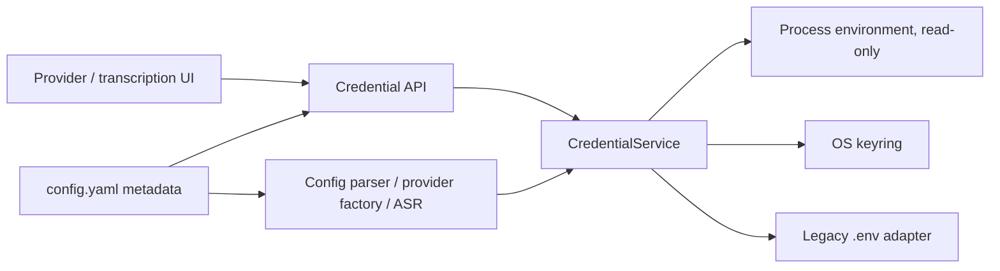

# Credential Management Design

**Status:** Implemented (2026-11-15); see the [implementation record](../reviews/2026-11-15-credential-management-implementation.md)
**Date:** 2026-11-15
**Scope:** Global AI provider keys, cloud transcription credentials, and future application passwords

## 1. Problem

Clio currently uses environment variables as the main credential boundary. Global provider
configuration stores `api_key_env`, the loader resolves that name through `os.environ`, and the Web
UI exposes a full `.env` editor. Provider editing also reads and rewrites the complete `.env`
document when a key is entered.

This is safe enough for the existing local-only workflow after masking and validation were added,
but it gives the UI the wrong abstraction. A user is managing a credential while looking at a text
file, the provider card cannot display the actual configured value, and every future credential type
would need another special case.

The design separates three concerns: a credential reference, a credential store, and credential UI.

## 2. Goals and non-goals

### Goals

- Manage credentials from Provider and transcription forms without opening `.env`.
- Provide one central inventory with status, source, consumers, and safe actions.
- Keep values out of YAML, ordinary API responses, logs, task records, browser storage, and URLs.
- Support Windows desktop use through the operating-system credential store.
- Preserve CLI, container, CI, and existing `.env` workflows.
- Make source precedence and shadowed credentials visible.
- Allow deliberate, authenticated reveal without making secrets part of normal GET responses.

### Non-goals

- A custom encryption format or password vault.
- A remote Clio credential service.
- Project-specific secrets in the first version.
- Removing `.env` support for automation or advanced users.

## 3. Recommended architecture



`CredentialService` is the only production entry point for resolving a named credential. Provider
constructors and ASR code receive the resolved value through their existing typed configuration
objects; they do not know whether the value came from a keyring, environment, or dotenv adapter.

The first implementation introduces the service and adapter interfaces while retaining dotenv as
the default compatibility path. Desktop builds can then enable a keyring adapter without changing
provider configuration or UI contracts.

### 3.1 Credential metadata

Metadata is safe to persist in global `config.yaml`; values are never persisted there:

```yaml
credentials:
  gemini_api_key:
    label: Gemini API key
    kind: api_key
    source: auto
    env_name: GEMINI_API_KEY
    backend_account: gemini_api_key
```

Provider entries reference metadata rather than carrying a secret:

```yaml
ai:
  providers:
    gemini:
      type: gemini
      credential_ref: gemini_api_key
      models: [gemini-3-flash]
```

`credential_ref` is stable configuration data. `api_key` and `api_key_env` remain accepted as
legacy input during migration, but new writes use `credential_ref` and strip inline values.

The generic model supports `api_key`, `access_key`, `secret`, and `password`. A registry entry has
an ID, label, kind, source policy, optional environment name, and backend account. It contains no
value, hash, prefix, or reversible representation of the secret. Status can include configured,
effective source, last four characters, and derived consumer references.

### 3.2 Store adapters and precedence

The service uses this contract:

```text
CredentialStore
  get(account) -> str | None
  set(account, value) -> None
  delete(account) -> None
  contains(account) -> bool
  describe(account) -> StoreMetadata
```

Adapters:

- **EnvironmentStore:** read-only process environment for deployment and CI.
- **KeyringStore:** preferred desktop backend through Python `keyring`, using a fixed Clio service
  namespace and stable account IDs.
- **DotenvStore:** compatibility backend for the current global `.env`, retaining atomic writes,
  permissions, masking, dangerous-variable rejection, and unrelated-entry preservation.
- **InlineLegacyStore:** read-only support for old `api_key`; never a write target.

`source: auto` resolves in this order: inherited process environment, keyring, legacy `.env`, then
legacy inline value. The effective source and any shadowed sources are returned to the UI. A UI save
chooses the target source explicitly; the default is keyring on desktop and dotenv when no keyring is
available. An inherited environment value is never silently overwritten by a UI save.

### 3.3 Runtime integration

`clio/config/parsers.py::_resolve_api_key` becomes a compatibility wrapper around
`CredentialService.resolve()`. `ProviderConfig.api_key` may remain as an internal resolved value in
the first migration step, while raw config and UI payloads stop treating it as editable.

Provider construction, doctor readiness, and ASR readiness use the same service and credential
policy. Ollama is explicitly credential-free through that policy rather than scattered special cases.

Credential changes invalidate affected provider entries. The provider cache lifetime issue recorded
as review finding R11 must be fixed first: retired clients close only after active calls finish.

## 4. API contract

Credential routes use existing local-session and API-token protections. Secret-bearing requests use
POST or PUT bodies; no secret is accepted in a query string or path segment.

### `GET /api/credentials`

Returns metadata only, including ID, label, kind, configured state, effective source, shadowed
sources, masked preview, consumers, and backend availability. It never returns a secret.

### `PUT /api/credentials/{id}`

Body: `{"value":"new-secret","source":"keyring"}`. An omitted value means no change; an
explicit empty value deletes the selected writable entry only after confirmation. The response is
metadata only, followed by reload and affected-provider invalidation.

### `POST /api/credentials/{id}/reveal`

Reveal is an explicit authenticated action, never part of GET or config loading. The response uses
`Cache-Control: no-store`; the UI clears it after a short timeout. The value is not logged. If the
effective source is inherited environment, the UI says so before allowing reveal.

### `DELETE /api/credentials/{id}`

Deletes the selected writable backend entry and reports remaining shadowed sources.

### Existing routes

- `/api/providers` remains the provider registry API, but responses contain `credential_ref`,
  configured state, and source metadata rather than `api_key` values.
- `/api/ai/test` may accept an ephemeral credential for a draft connection test; it never persists
  or echoes that value.
- `/api/env` remains an advanced compatibility editor for non-secret environment settings. Managed
  credential entries are marked as owned by Credential Manager and link back to it.

## 5. Web UI

Every credential-bearing form uses a shared component:

```text
API key
Configured · Keyring
[Replace] [Reveal] [Test connection]
```

The current fake “show key” control is removed. The shared component never puts a secret in provider
objects, DOM attributes, URLs, browser storage, or the raw config editor. Global Settings gains a
Credentials panel listing credentials, consumers, source, migration notices, and actions.

All new copy is added to both locale catalogs. Provider forms call field-level credential APIs and
stop doing client-side full-file `.env` read/modify/write.

## 6. Migration

Migration is read-compatible and reversible:

1. Discover providers using `api_key_env`, inline `api_key`, and built-in credential names.
2. Synthesize deterministic IDs such as `gemini_api_key` in memory.
3. Show whether the effective value came from process environment, `.env`, or inline config.
4. On explicit migration, copy the selected value to the preferred writable backend, write
   `credential_ref`, remove inline `api_key`, and retain `api_key_env` as a compatibility hint.
5. Never delete the old `.env` entry automatically; offer cleanup after verification.
6. If keyring is unavailable, migrate to `.env` and report the fallback.

Provider rename and URL changes continue to require possession proof and explicit credential
reassignment.

## 7. Testing and delivery

Tests must cover source precedence, shadowing, keyring unavailability, metadata redaction,
authenticated reveal, atomic dotenv operations, migration, keyless Ollama, and provider retirement
after active calls. Frontend tests cover status, replace, reveal timeout, raw `.env` guidance, and
matching zh-CN/en catalogs.

Delivery order:

1. Service contract, metadata model, and dotenv-backed adapter.
2. Credential routes, inventory, shared field component, and removal of the fake reveal behavior.
3. Optional keyring backend and desktop capability detection.
4. Explicit migration and legacy cleanup.
5. Rotation hardening after R11 is fixed.
